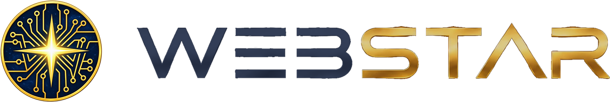
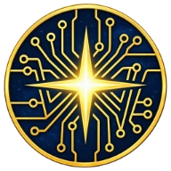
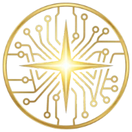

<picture>
  <source media="(prefers-color-scheme: dark)" srcset="assets/webstar-lockup-dark-1200.webp">
  
</picture>

### Um universo de soluções, conectado para escalar.

**Tecnologia • Integração • Automação • Crescimento**

*Guiamos a transformação. Conectamos soluções. Impulsionamos negócios.*

---

**WebStar** é uma startup brasileira, marca-mãe de um ecossistema de soluções especializadas que reúne gestão, emissão
fiscal, atendimento com inteligência artificial e presença digital para pequenos negócios. O **Universo WebStar** é a sua
plataforma de **Transformação Digital como Serviço (TDaaS)**.

> **Grandes ferramentas não deveriam ser privilégio das grandes empresas.**

## O ecossistema

Da visão ao universo, do universo às soluções.

| Peça | Na narrativa | Slogan | O que é |
|---|---|---|---|
|  **[Mr. Star WebMaster](https://mrstar.com.br)** | A visão | *A estrela-guia na transformação digital do seu negócio.* | Consultoria e direção técnica com Deivison Estrela, fundador da WebStar. |
|  **[Universo WebStar](https://universowebstar.com.br)** | O universo e a vitrine | *Um universo de soluções, conectado para escalar.* | Transformação Digital como Serviço: presença digital, marca, campanhas, automações e implantação, conectadas ao WebStar System e ao WebStar CRM. |
|  **[WebStar System](https://webstar.app.br)** | O cérebro | *Sua empresa no Universo Digital.* | Gestão, PDV e emissão de notas fiscais num só sistema, com o motor da Reforma Tributária desenvolvido pela WebStar. |
|  **[WebStar CRM e a Estrela](https://crm.webstar.app.br)** | A voz | *Conexões inteligentes. Mais oportunidades de negócio.* | Atendimento no WhatsApp, funil de vendas, agenda e automações, com a Estrela, assistente de IA configurada com as informações da sua empresa. |
| **[WebStar Apps](https://webstar.app.br/ecossistema#aplicativos)** | As mãos | *Seu negócio em rotação.* | PDV Off, App Garçom, Autoatendimento e App de Delivery para o balcão, o salão e o delivery. |
| **[Super Combo Transformação Digital](https://webstar.app.br/super-combo)** | A oferta | *Sua empresa inteira. Um só universo.* | Gestão, nota fiscal, atendimento com IA no WhatsApp e presença digital, implantados e acompanhados por uma equipe só. |

## WebStar System — o cérebro

- **Motor da Reforma Tributária próprio**, com a calculadora oficial integrada como conferência.
- Emite **NF-e, NFC-e, NFS-e, CT-e, CT-e OS e MDF-e**, conforme o plano e o município.
- A nota errada é barrada antes de sair: o XML é **validado contra o XSD oficial antes de transmitir**.
- **Estoque, compras por XML, financeiro e caixa integrados**; o seu contador recebe o XML automaticamente.
- Isolamento por empresa, permissões em duas camadas, senha do certificado cifrada e DANFE por link de 48 h.
- Empresas reais já usam e emitem nota em produção.

## WebStar CRM e a Estrela — a voz

A **Estrela** responde a qualquer hora com o que a empresa cadastrou, qualifica, agenda e passa a conversa para uma
pessoa quando precisa.

| A Estrela faz | A Estrela não faz |
|---|---|
| Responde a qualquer hora com as informações que a empresa cadastrou | Não inventa preço nem prazo |
| Qualifica o contato e registra no funil | Não cobra nem emite nota fiscal |
| Agenda na agenda da empresa | Não fecha venda sozinha: prepara e passa para uma pessoa |
| Acompanha quem não respondeu | Não dispara mensagens em massa |
| Passa a conversa para uma pessoa quando precisa | Não substitui o dono nas decisões |

A Estrela usa o WhatsApp da sua empresa e um provedor de inteligência artificial; o consumo do provedor é informado
antes da contratação.

## WebStar Apps — as mãos

| App | Para |
|---|---|
| **PDV Off** | O caixa que continua vendendo sem internet — a nota sai quando a conexão volta (Windows). |
| **App Garçom** | Comandas e pedidos no salão (Android). |
| **Autoatendimento** | Cardápio digital no totem e na TV (Android e Android TV). |
| **App de Delivery** | Cardápio e pedidos online por loja (PWA). |

## Super Combo Transformação Digital

Gestão, nota fiscal, vendas, atendimento com inteligência artificial no WhatsApp e presença digital — conectados,
implantados com você e acompanhados por uma equipe só.

| Nível | Para quem |
|---|---|
| **Decolagem** | MEI e autônomo: gestão, Estrela essencial, página e perfil no Google |
| **Super Combo** | Pequena empresa: gestão com nota fiscal, Estrela completa, página, perfil no Google, kit de marca, campanha de lançamento, implantação e diagnóstico com Mr. Star |
| **Galáxia** | Multicanal: sob proposta |

**Investimento definido no diagnóstico.** À parte: certificado digital A1, verba de anúncio, consumo do provedor de IA,
domínio e equipamentos.

**[Quero meu diagnóstico gratuito](https://webstar.app.br/super-combo)** — uma conversa de 20 minutos.

## Quem está por trás

**Deivison Estrela, o Mr. Star**, é bacharel em Sistemas de Informação e constrói soluções digitais para pequenos
negócios do Distrito Federal desde 2017. Criou o WebStar System e lidera o ecossistema WebStar.

| Ano | Marco |
|---|---|
| 2017 | Deivison Estrela começa a criar sites para pequenos negócios do DF como Mr. Star WebMaster. |
| 2020 | Nasce a ideia do WebStar System: unir loja, estoque e nota fiscal num só lugar. |
| 2023 | Primeira versão do WebStar System em uso por empresas. |
| 2026 | Motor próprio da Reforma Tributária, WebStar CRM com a Estrela e aplicativos 2.0. |
| jan/2027 | Lançamento oficial do Universo WebStar (previsto). |

## Construído antes de ser anunciado

O código do ecossistema é privado; a forma de trabalhar, não.

- **Doze projetos, um padrão:** `main` protegida, toda mudança entra por pull request com checagem automática e merge
  squash; versões publicadas são imutáveis.
- **Histórico legível:** mensagens em Conventional Commits, documentação e changelog atualizados em cada entrega.
- **Dependências vigiadas:** atualizações semanais automatizadas e alertas de segurança ligados em todos os projetos.
- **Uma identidade só:** um Design System alimenta o WebStar System, o WebStar CRM e os sites, conferido entre projetos.

Stack: Laravel e PHP 8.3 · FastAPI e Python 3.12 · React e TypeScript · Angular, Ionic, Capacitor e Electron · MariaDB e Redis.

## Fale com a WebStar

| | |
|---|---|
| **WhatsApp** | (61) 99421-3850 |
| **Contato** | [contato@universowebstar.com.br](mailto:contato@universowebstar.com.br) |
| **Comercial** | [vendas@universowebstar.com.br](mailto:vendas@universowebstar.com.br) |
| **Clientes** | [suporte@universowebstar.com.br](mailto:suporte@universowebstar.com.br) |
| **Atendimento humano** | Segunda a sexta, das 9h às 12h e das 13h às 18h; sábado, das 9h às 13h (horário de Brasília) |
| **Estrela** | A qualquer hora, com base nas informações cadastradas |

[WebStar System](https://webstar.app.br) · [Super Combo](https://webstar.app.br/super-combo) · [WebStar CRM](https://crm.webstar.app.br) · [WebStar Apps](https://webstar.app.br/ecossistema#aplicativos) · [Universo WebStar](https://universowebstar.com.br) · [Mr. Star](https://mrstar.com.br) · [Novidades](https://webstar.app.br/novidades) · [Imprensa](https://webstar.app.br/imprensa)

**Você cuida do negócio. A WebStar conecta o resto.**

